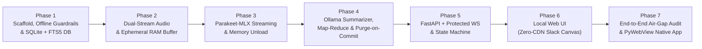

# Phase-Wise Implementation & Verification Plan: Zero-Trust Local Meeting Assistant

**Reference Architecture:** [local_meeting_assistant_architecture.md](file:///Users/kunchum/study/local_meeting_assistant/architecture/local_meeting_assistant_architecture.md)  
**Target Directory:** `/Users/kunchum/study/local_meeting_assistant/`

---

## Overview of Phases



| Phase | Milestone | Key Deliverable | Core Requirement Verified |
| :--- | :--- | :--- | :--- |
| **Phase 1** | Foundation, Offline Lock & Database | `config.py`, `database.py`, `schemas.py`, `verify_offline.sh` | Zero telemetry flags, SQLite WAL + FTS5 + normalized `action_items`, `secure_delete=ON` |
| **Phase 2** | Dual-Stream Audio Capture & PCM Scrubbing | `audio_engine.py` | Mic (`[Me]`) + BlackHole (`[Others]`) 48k$\rightarrow$16k resampling, VAD gate, immediate PCM buffer zeroing |
| **Phase 3** | Real-Time MLX Transcription & Cache Unload | `transcriber.py` | `parakeet-mlx` streaming context, RAM-only transcript list, zero `.wav`/`.txt` files, `mx.clear_cache()` unload |
| **Phase 4** | Local LLM Summarizer & Map-Reduce | `summarizer.py` | `num_ctx: 32768`, `keep_alive: 0`, Slack AI–style `TopicTakeaway` grouping, timestamp-prefixed titles, $>12\text{K}$ token map-reduce, **Purge-on-Commit** |
| **Phase 5** | Protected FastAPI Backend & WebSocket | `main.py`, `run_local.sh` | `127.0.0.1` binding, `X-Local-Session-Token` + `Origin` check, lifecycle state machine, retry flow |
| **Phase 6** | 100% Local Web Frontend (Zero CDN) | `frontend/*` (`index.html`, `app.js`, `styles.css`, `vendor/*`) | Strict CSP, dual audio meters, live preview, inline edits, action item checkboxes, Markdown copy |
| **Phase 7** | Full Air-Gap Verification & Native macOS App | `desktop_wrapper.py`, E2E test suite | Complete offline meeting test (Wi-Fi off / socket audit) + native macOS `.app` window |

---

## Phase 1: Project Scaffold, Offline Guardrails & SQLite Database Layer

### What We Build
1. **Project Structure & Dependencies:**
   - Create `requirements.txt` (including `pytest`, `pytest-asyncio`, `httpx`), `glossary.yaml`, `run_local.sh`, and `verify_offline.sh`.
2. **Offline & Security Config (`backend/config.py`):**
   - Enforce and assert offline environment variables (`HF_HUB_OFFLINE=1`, `TRANSFORMERS_OFFLINE=1`, `HF_DATASETS_OFFLINE=1`, `DO_NOT_TRACK=1`, `ANONYMIZED_TELEMETRY=False`, `OLLAMA_NOHISTORY=1`, `OLLAMA_DEBUG=0`).
   - Generate the per-boot 256-bit `SESSION_TOKEN = secrets.token_urlsafe(32)`.
3. **Pydantic Schemas (`backend/schemas.py`):**
   - `TopicTakeaway`, `ExtractedActionItem`, `MeetingNotesOutput`, `ActionItemDB`, `MeetingResponse`, `MeetingUpdateRequest`, `HealthResponse`.
4. **SQLite + WAL + FTS5 Layer (`backend/database.py`):**
   - Initialize `local_meetings.db` with `PRAGMA journal_mode = WAL`, `PRAGMA secure_delete = ON`, `PRAGMA foreign_keys = ON`.
   - Create `meetings`, `action_items`, `meetings_fts`, and sync triggers.
   - Implement CRUD functions, sanitized FTS5 search (`"token"*`), and `PRAGMA wal_checkpoint(TRUNCATE)` on meeting deletion.

### Automated Tests (`tests/test_phase1_db_and_config.py`)
- `test_offline_env_assertions()`: Verifies `config.py` sets/validates all offline flags and generates a 32-byte URL-safe token.
- `test_sqlite_pragmas()`: Queries `PRAGMA journal_mode`, `PRAGMA secure_delete`, and `PRAGMA foreign_keys` to confirm `wal`, `1`, and `1`.
- `test_meeting_and_action_items_crud()`: Inserts a meeting with 3 action items, toggles `done` on one item, verifies chronological ordering (`created_at DESC`) and open-task filtering.
- `test_fts5_sanitized_search()`: Searches with special characters (`"Q4 & Roadmap (release)"*`) to verify FTS5 never throws a syntax error and returns matching meetings.
- `test_secure_delete_and_wal_truncate()`: Inserts a meeting with a unique canary string `"SECRET_CANARY_99281"`, deletes the meeting, and reads the raw `.db` and `-wal` bytes on disk to confirm `"SECRET_CANARY_99281"` is completely absent from disk bytes.

### How You Can Test It Yourself
```bash
# 1. Run Phase 1 automated test suite
pytest tests/test_phase1_db_and_config.py -v

# 2. Inspect the SQLite database pragmas and tables directly
python3 -c "
from backend.database import init_db, get_db_connection
init_db()
conn = get_db_connection()
print('Journal Mode:', conn.execute('PRAGMA journal_mode').fetchone()[0])
print('Secure Delete:', conn.execute('PRAGMA secure_delete').fetchone()[0])
"
```
**Pass Criteria:** All pytest tests pass, `journal_mode` prints `wal`, `secure_delete` prints `1`, and the canary deletion test confirms deleted strings are wiped from the `.db` and `-wal` files.

---

## Phase 2: Dual-Stream Audio Capture, Resampling & Ephemeral PCM Scrubbing

### What We Build
1. **Audio Engine (`backend/audio_engine.py`):**
   - Enumerate macOS input devices via `sounddevice.query_devices()` and auto-detect default Mic and `BlackHole 2ch`.
   - Capture two independent streams: Mic (`[Me]`) and System/BlackHole (`[Others]`) at native sample rate (e.g. 48kHz).
   - Downmix stereo to mono and resample 48kHz $\rightarrow$ 16kHz float32 in memory using `scipy.signal.resample_poly`.
   - Compute real-time RMS level (`mic_rms`, `system_rms`) and apply an RMS/VAD silence gate so dead air is skipped.
   - **Zero-Accumulation Scrubbing:** Push 5-second windows (with 0.5s context overlap) to an in-memory queue for the transcriber, and immediately overwrite the source `numpy` buffer with `buf.fill(0)`.

### Automated Tests (`tests/test_phase2_audio_engine.py`)
- `test_resampling_48k_stereo_to_16k_mono()`: Feeds synthetic 48kHz stereo sine wave numpy arrays into the DSP pipeline and verifies output shape is `(16000 * seconds,)` mono `float32`.
- `test_silence_gate_drops_dead_air()`: Feeds near-zero amplitude noise and confirms the VAD/RMS gate does not enqueue chunks for transcription.
- `test_pcm_buffer_zeroed_after_consume()`: Verifies that after a chunk is handed off, the underlying ring buffer slice contains all `0.0`s and zero `.wav`/`.raw` files exist anywhere in the project or `/tmp`.

### How You Can Test It Yourself
```bash
# 1. Run Phase 2 unit tests
pytest tests/test_phase2_audio_engine.py -v

# 2. Live 5-second Dual-Mic/BlackHole Meter Check (CLI diagnostic mode)
python3 -m backend.audio_engine --test-meters --seconds 5
```
**Pass Criteria:** Speaking into your MacBook microphone moves the `Mic [Me] RMS` bar; playing any local audio/video moves the `System [Others] RMS` bar; and `find . /tmp -name "*.wav"` shows zero audio files created.

---

## Phase 3: `parakeet-mlx` Streaming Transcription & Unified Memory Unload

### What We Build
1. **Streaming Transcriber (`backend/transcriber.py`):**
   - Load `mlx-community/parakeet-tdt-0.6b-v3` from local cache (`HF_HUB_OFFLINE=1` enforced) with optional fallback to `mlx-community/whisper-large-v3-turbo`.
   - Consume `[Me]` and `[Others]` 16kHz numpy chunks from `audio_engine.py`, transcribe them, and append formatted lines (`"[Me] ..."`, `"[Others] ..."`) to the ephemeral Python `list[str]` in RAM.
   - Expose `unload_asr_model()` which deletes the model object, runs `gc.collect()`, and calls `mlx.core.clear_cache()` (`mx.clear_cache()`) so the ~1.2–1.5 GB of MLX Unified Memory is freed before Ollama runs.

### Automated Tests (`tests/test_phase3_transcriber.py`)
- `test_offline_model_load_blocks_network(monkeypatch)`: Monkeypatches `socket.socket.connect` to raise an error on any outbound connection and verifies `transcriber.py` loads from local cache without touching the network.
- `test_speaker_tagging_and_ram_buffer()`: Feeds a synthetic spoken audio array tagged `Me` and `Others`, verifies `transcript_segments` contains `"[Me] ..."` and `"[Others] ..."`, and verifies `purge_transcript()` empties the list to length `0`.
- `test_mlx_memory_unload()`: Loads the ASR model, checks `mx.get_active_memory() + mx.get_cache_memory()`, calls `unload_asr_model()`, and verifies MLX memory drops back to near zero.

### How You Can Test It Yourself
```bash
# 1. Run Phase 3 tests
pytest tests/test_phase3_transcriber.py -v

# 2. Live 10-second offline transcription smoke test (Wi-Fi can be turned OFF)
HF_HUB_OFFLINE=1 python3 -m backend.transcriber --live-demo --seconds 10
```
**Pass Criteria:** As you speak for 10 seconds (even with Wi-Fi completely turned off), your speech prints live in the terminal tagged `[Me]`, and at the end of 10 seconds the script prints `MLX Memory after unload: 0.0 MB` and `Transcript buffer length after purge: 0`.

---

## Phase 4: Ollama Summarizer, Long-Meeting Map-Reduce & Purge-on-Commit

### What We Build
1. **Summarizer Engine (`backend/summarizer.py`):**
   - Wrap transcript segments inside `<transcript>...</transcript>` delimiters with the prompt-injection guard (jargon parsed as-is, no `glossary.yaml`).
   - Enforce Slack AI–style `TopicTakeaway` (`topic` + non-empty `bullets`) in `MeetingNotesOutput` so local models reliably populate grouped takeaways, and prefix saved meeting titles with the local timestamp (`YYYY-MM-DD HH:MM — <Model Title>`).
   - Call `http://127.0.0.1:11434/api/chat` with:
     - `format=MeetingNotesOutput.model_json_schema()`
     - `options={"temperature": 0.0, "num_ctx": 32768}`
     - `keep_alive=0` (immediately evicts LLM weights + KV cache from RAM after response).
   - **Map-Reduce for Long Meetings ($>12,000$ tokens):** Automatically chunk transcripts exceeding 12,000 estimated tokens into 10-minute overlapping windows, summarize each chunk, and reduce into the final `MeetingNotesOutput` schema.
   - **Purge-on-Commit Coordinator:** Only clear `transcript_segments` after `database.create_meeting()` commits. If Ollama fails, preserve `transcript_segments` in RAM and surface the error for retry.

### Automated Tests (`tests/test_phase4_summarizer.py`)
- `test_ollama_payload_contract()`: Verifies the request sent to `127.0.0.1:11434/api/chat` always includes `num_ctx: 32768`, `keep_alive: 0`, `temperature: 0.0`, `<transcript>` tags, and `MeetingNotesOutput.model_json_schema()`.
- `test_long_transcript_triggers_map_reduce()`: Generates a synthetic 16,000-token transcript (with a specific decision in minute 2 and an action item in minute 58) and verifies the map-reduce path runs and preserves both the minute-2 decision and minute-58 action item.
- `test_purge_on_commit_retains_ram_on_ollama_failure()`: Simulates an Ollama timeout/500 error and asserts `len(transcript_segments) > 0` (no data loss); then simulates a successful retry with `llama3.1:8b` and asserts `len(transcript_segments) == 0` and the meeting is saved in SQLite.

### How You Can Test It Yourself
```bash
# 1. Run Phase 4 unit & integration tests
pytest tests/test_phase4_summarizer.py -v

# 2. Run a real local Ollama test with phonetic mis-transcriptions ("Cooper-net-ies", "Sequel Lite")
python3 -m backend.summarizer --test-sample
# Then immediately check that Ollama unloaded the model from RAM (keep_alive=0):
ollama ps
```
**Pass Criteria:**
1. The output JSON normalizes phonetic variations (`"Cooper-net-ies"` $\rightarrow$ `"Kubernetes"`, `"Sequel Lite"` $\rightarrow$ `"SQLite"`) and assigns `[Me]` tasks to `owner: "Me"`.
2. Running `ollama ps` right after the command finishes shows **0 models loaded in RAM** (proving `keep_alive: 0` evicted the model and prompt KV cache).

---

## Phase 5: FastAPI Server, Anti-Hijacking Security & WebSocket State Machine

### What We Build
1. **FastAPI Application (`backend/main.py`) & `run_local.sh`:**
   - Enforce `TrustedHostMiddleware(allowed_hosts=["127.0.0.1"])`.
   - Middleware validating `X-Local-Session-Token` and `Origin: http://127.0.0.1:8000` on all `/api/*` mutations and `/ws/live`.
   - Implement all 12 REST endpoints (`/api/health`, `/api/meetings`, `/api/action-items/{id}`, `/api/meeting/start`, `/api/meeting/stop`, `/api/meeting/retry-summarize`, `/api/meeting/discard`) and the `WS /ws/live` streamer.
   - Implement `atexit`, `SIGINT`, and `SIGTERM` handlers to scrub RAM buffers on server shutdown.

### Automated Tests (`tests/test_phase5_api_and_security.py`)
- `test_rejects_missing_or_invalid_session_token()`: Verifies `GET /api/meetings`, `POST /api/meeting/start`, and `WS /ws/live` return `403 Forbidden` without the valid `SESSION_TOKEN`.
- `test_rejects_cross_origin_websocket_hijack()`: Attempts to connect to `WS /ws/live` with `Origin: https://evil.example.com` and confirms immediate `403` rejection.
- `test_csp_headers_present()`: Verifies `GET /` returns the strict `Content-Security-Policy` header blocking all external connections.
- `test_state_machine_conflict_and_retry_flow()`: Verifies calling `POST /api/meeting/start` twice returns `409 Conflict`, and verifies `RECORDING -> SUMMARIZATION_FAILED -> retry-summarize -> IDLE`.

### How You Can Test It Yourself
```bash
# 1. Run Phase 5 security & API tests
pytest tests/test_phase5_api_and_security.py -v

# 2. Start the server and test that an unauthenticated request is blocked:
./run_local.sh &
curl -i http://127.0.0.1:8000/api/meetings
# Expected: HTTP/1.1 403 Forbidden
```
**Pass Criteria:** All pytest security tests pass, and any `curl` or WebSocket request without the session token or from a foreign `Origin` is rejected with `403 Forbidden`.

---

## Phase 6: 100% Local Frontend UI (Zero-CDN Slack Canvas Workspace)

### What We Build
1. **Local Vendor Assets (`frontend/vendor/`):**
   - Bundle local CSS and SVG icons so zero external requests to `cdn.tailwindcss.com`, `unpkg.com`, or Google Fonts ever occur.
2. **Frontend Application (`frontend/index.html`, `frontend/styles.css`, `frontend/app.js`):**
   - **Left Sidebar:** `100% Offline • M5 MLX` badge, instant search input, `All Meetings` | `Open Action Items` filter tabs, and chronological grouping (`Today`, `Yesterday`, `Earlier This Week`, `Older`).
   - **Top Recording Bar:** Mic (`[Me]`) & System (`[Others]`) device selectors, LLM selector (`qwen2.5:14b`, `qwen3:14b`, `gemma3:12b`, `qwen3:8b`, `llama3.1:8b`), dual animated RMS audio meters, live timer, RAM word/token counter, collapsible live transcript drawer, `End & Summarize`, `Discard`, and the `SUMMARIZATION_FAILED` retry banner.
   - **Main Meeting Canvas:** Inline-editable timestamp-prefixed title, summary, and Slack AI–style topic-grouped takeaways (`Topic` + nested sub-bullets, plus legacy flat-string support); interactive action item checklist (`<task> — Owner: @<owner>` + `Deadline: <due_date>`) with instant checkbox persistence (`PATCH /api/action-items/{id}`), owner pills (`@Me` highlighted in blue), `+ Add Action Item` input, and `Copy as Slack/Markdown` button.

### Automated Tests (`tests/test_phase6_frontend_assets.py`)
- `test_zero_external_urls_in_frontend()`: Scans `frontend/index.html`, `frontend/styles.css`, and `frontend/app.js` with regex to assert there are zero `https://` or `//` URLs pointing to external CDNs, fonts, or analytics.
- `test_index_injects_session_token_and_csp()`: Requests `GET /` and verifies the HTML contains the strict CSP meta tag and the injected per-boot session token.

### How You Can Test It Yourself
1. Launch `./run_local.sh` and open `http://127.0.0.1:8000` in your browser.
2. Open Browser **DevTools $\rightarrow$ Network tab**:
   - Reload the page. Confirm **100% of requests go to `127.0.0.1:8000`** (zero third-party domains, zero failed CDN calls).
3. Test the UI workflow:
   - Select your Mic and `BlackHole 2ch`, click **`● Start Live Meeting`**, and watch the dual audio meters, timer, word counter, and live preview update.
   - Click **`■ End & Summarize`**, verify the structured notes appear under **Today**, toggle an action item checkbox, reload the page to confirm the checkbox state persisted, and click **`Copy as Slack/Markdown`**.

---

## Phase 7: End-to-End Air-Gap Audit & Phase 2 Native macOS App (`PyWebView`)

### What We Build
1. **Native macOS Desktop Wrapper (`desktop_wrapper.py`):**
   - Launches FastAPI on `127.0.0.1:8000` inside a background thread, opens the native macOS `PyWebView` window (`Local Meeting Notes`), and binds `window.events.closed += purge_ephemeral_buffers`.
2. **End-to-End Offline & Zero-Leakage Verification Suite (`tests/test_phase7_e2e_airgap.py` & `verify_offline.sh`):**
   - Full lifecycle E2E test verifying audio capture $\rightarrow$ transcription $\rightarrow$ MLX cache unload $\rightarrow$ Ollama summarization $\rightarrow$ SQLite persistence $\rightarrow$ RAM buffer purge $\rightarrow$ zero disk artifacts.

### Final End-to-End Acceptance Checklist (How You Verify Everything)

Run this 4-step acceptance test on your MacBook Pro:

1. **Turn Wi-Fi Completely OFF** on your MacBook Pro.
2. Launch the app (`./run_local.sh` or `python3 desktop_wrapper.py`).
3. Record a 2-minute test meeting where you say:
   > *"In our Q4 architecture review, I will benchmark the Sequel Lite database and Fast A-P-I routes by Friday, and Sarah will update the Cooper-net-ies deployment next Tuesday."*
4. Click **`■ End & Summarize`** and verify:
   - **Offline Verification:** Run `./verify_offline.sh` — outputs `PASS: 100% Loopback-Only (Zero External Connections)`.
   - **Glossary & Speaker Attribution:** Phonetic variations are normalized (`"Sequel Lite"` $\rightarrow$ `"SQLite"`, `"Fast A-P-I"` $\rightarrow$ `"FastAPI"`, `"Cooper-net-ies"` $\rightarrow$ `"Kubernetes"`), your task is assigned `owner: "Me"` with `due_date: "Friday"`, and Sarah's task is assigned `owner: "Sarah"`.
   - **Zero Raw Files on Disk:** Run `find . -name "*.wav" -o -name "*.mp3" -o -name "*.txt"` — returns zero audio or raw transcript files.
   - **Zero Raw Transcript in SQLite:** Run `sqlite3 local_meetings.db "SELECT * FROM meetings;"` — confirms only the structured summary and takeaways are stored, not your verbatim transcript.
   - **Zero Lingering LLM Context in RAM:** Run `ollama ps` — confirms `qwen2.5:14b` was immediately unloaded after summarization (`keep_alive: 0`).
